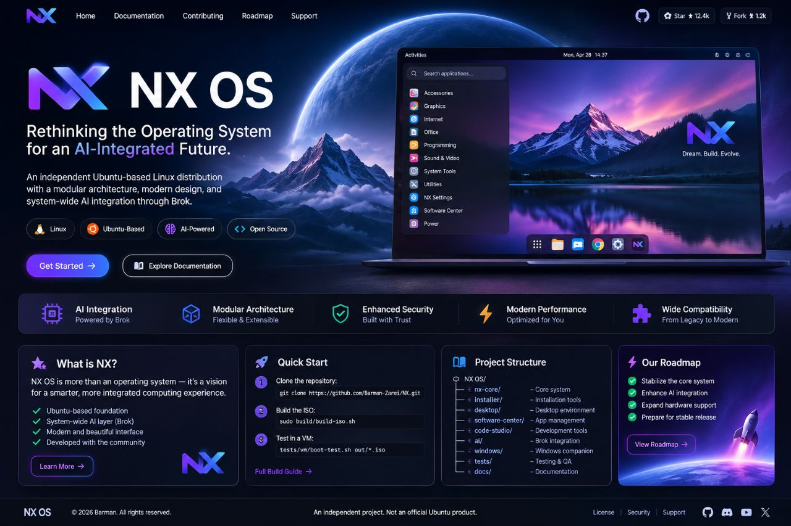

<div align="center">



# NX OS

### Rethinking the Operating System for an AI-Integrated Future

**An independent Ubuntu-based Linux distribution exploring a modular operating-system foundation and planned AI integration through Brok.**

[](https://github.com/Barman-Zarei/NX)
[](https://ubuntu.com/)
[](BUILD.md)
[](LICENSES.md)

**[Overview](#overview) · [Build](#build-from-source) · [Documentation](#documentation) · [Contributing](#contributing)**

</div>

> [!NOTE]
> **About the banner:** The image above is concept artwork created to communicate the project's visual direction. It is not a screenshot of a released NX desktop, and the interface elements shown in the artwork should not be interpreted as implemented features.

> [!IMPORTANT]
> **Development status: Experimental**
>
> NX OS is under active development. Installation has been described as VM-tested only, and the project is not ready for production use. Check the current status and test results before relying on any feature. Do not install experimental builds on a computer containing important data.

## Overview

NX OS is an independent Linux distribution based on Ubuntu. Its long-term goal is to explore a more integrated computing experience, including a planned AI layer built around [Brok](https://github.com/Barman-Zarei/Brok).

The project is being developed incrementally. The repository includes operating-system and build-related components, installation and desktop-related code, compatibility resources, testing tools, documentation, and a planned AI integration area.

NX is not simply a launcher or a single desktop application: it is intended to become an installable operating-system distribution. The current state of each component must be evaluated from its implementation, documentation, and test results.

**Project principles**
- **Modular engineering:** keep system components and supporting tools organized.
- **Verifiable progress:** distinguish existing code from tested behavior and future plans.
- **Practical compatibility:** document constraints and validate support through testing.
- **Responsible experimentation:** treat installation, boot, and recovery behavior as safety-critical.
- **AI-oriented direction:** investigate integration with Brok without claiming planned functionality is already complete.

## Project status at a glance

| Area | Current understanding |
|---|---|
| Distribution foundation | Under development |
| ISO build tooling | Build workflow is present; see `BUILD.md` |
| Virtual-machine boot testing | Test tooling is present; see `TESTING.md` |
| Installation | Experimental; review the installation guide |
| Windows ISO checksum utility | Present in the repository |
| Brok integration | Planned; not to be treated as implemented without code and tests |
| Physical-hardware compatibility | Must be verified per configuration |
| Production readiness | Not established |

For authoritative details, read [`FEATURES.md`](FEATURES.md), [`ROADMAP.md`](ROADMAP.md), and [`TESTING.md`](TESTING.md). Repository contents and implementation may change.

## Architecture

The repository separates the operating-system foundation, build and installation tooling, user-facing components, AI-related work, compatibility, and verification.

```text
NX/
├── nx-core/              # Core system-related implementation
├── build/                # ISO build scripts and configuration
├── installer/            # Installation-related components
├── desktop/overlay/      # Desktop overlay-related components
├── software-center/      # Software-management-related development
├── code-studio/          # NX Studio Code (git submodule: Barman-Zarei/NX-Studio-Code, branch main); clone with --recurse-submodules
├── ai/                   # AI-related code and planned integration
├── windows/media-tool/   # Windows ISO checksum utility
├── compatibility/        # Compatibility resources
├── tests/                # Unit and VM boot-test tooling
└── docs/                 # Supporting documentation
```

This is a repository map, not a complete runtime dependency diagram. See [`ARCHITECTURE.md`](ARCHITECTURE.md) for implementation details.

## Build from source

The documented ISO build environment is Ubuntu 24.04. For the complete, current workflow, consult [`BUILD.md`](BUILD.md).

### Install build dependencies

```bash
sudo apt update
sudo apt install \
  debootstrap \
  xorriso \
  squashfs-tools \
  grub-pc-bin \
  grub-efi-amd64-bin \
  mtools \
  qemu-system-x86
```

### Build the ISO

Run from the repository root:

```bash
sudo build/build-iso.sh
```

The workflow is expected to write an ISO image and a SHA-256 checksum file under `out/`, using the naming convention configured by the project. Check the actual build output for filenames and errors.

### Test booting in QEMU

After the ISO is built:

```bash
tests/vm/boot-test.sh out/*.iso
```

The documented test workflow can use QEMU TCG emulation when `/dev/kvm` is unavailable.

A successful build does not prove that the image boots. A successful VM boot does not prove that installation is safe, that all features work, or that physical hardware is supported.

> [!WARNING]
> Review scripts before running commands with elevated privileges. Prefer an isolated virtual machine for initial evaluation. Do not assume an experimental installer preserves existing disks, partitions, files, or operating systems.

## Installation and safety

Read [`docs/installation/empty-disk.md`](docs/installation/empty-disk.md) before attempting installation.

Until installation, disk-selection, and recovery behavior have been adequately validated, use an isolated virtual machine. Back up important data independently, and do not use an important daily-use computer as an experimental target.

See [`SECURITY.md`](SECURITY.md) for security guidance and known limitations.

## Compatibility

The current documented build environment is Ubuntu 24.04. Virtual-machine testing uses QEMU, with KVM where available and TCG emulation otherwise.

The Windows companion utility targets Windows 7 and newer and uses Qt 5.15 / PySide2 with Python 3.8.

Legacy hardware is a compatibility objective, not a universal support guarantee. Compatibility can depend on firmware, CPU architecture, memory, graphics hardware, storage, and drivers. See [`COMPATIBILITY.md`](COMPATIBILITY.md) for the latest documented constraints.

## Testing and verification

NX includes a testing area for unit tests and virtual-machine boot testing. Always distinguish between:

1. A test script existing.
2. A test actually running.
3. A test passing in a named environment.
4. A feature working beyond the test's coverage.
5. A system being safe and reliable for general use.

When documenting a result, record the environment, command, expected behavior, actual result, and limitations. See [`TESTING.md`](TESTING.md).

## Roadmap

NX is being developed incrementally. Broad areas of work include:

- maintaining the ISO build workflow;
- improving repeatable testing and verification;
- documenting installation and hardware compatibility;
- developing the planned Brok integration;
- evolving desktop and software-management components;
- improving contribution and developer workflows.

These are development directions, not release promises. Use [`ROADMAP.md`](ROADMAP.md) for the project's recorded plans and [`CHANGELOG.md`](CHANGELOG.md) for recorded changes.

## Documentation

| Document | Purpose |
|---|---|
| [`ARCHITECTURE.md`](ARCHITECTURE.md) | Architecture and component organization |
| [`BUILD.md`](BUILD.md) | Build requirements and ISO generation |
| [`COMPATIBILITY.md`](COMPATIBILITY.md) | Compatibility constraints and environment details |
| [`FEATURES.md`](FEATURES.md) | Feature descriptions and implementation status |
| [`FEATURE_PRESERVATION.md`](FEATURE_PRESERVATION.md) | Feature-preservation planning |
| [`ROADMAP.md`](ROADMAP.md) | Development direction and milestones |
| [`TESTING.md`](TESTING.md) | Test procedures and verification |
| [`SECURITY.md`](SECURITY.md) | Security guidance |
| [`CONTRIBUTING.md`](CONTRIBUTING.md) | Contribution workflow |
| [`CHANGELOG.md`](CHANGELOG.md) | Recorded changes |
| [`LICENSES.md`](LICENSES.md) | Licensing information |
| [`Installation guide`](docs/installation/empty-disk.md) | Experimental installation instructions |
| [`Current status`](docs/releases/STATUS.md) | Milestone and status details, if present in this checkout |

If a link does not resolve in the current branch, check the repository for the correct path and update the link before publishing.

## Contributing

Constructive contributions are welcome: reproducible bug reports, documentation improvements, tests, compatibility investigations, architecture feedback, and focused code changes.

Before opening a pull request:

1. Read the relevant documentation and existing issues.
2. Explain the problem and the rationale for the change.
3. Keep the change focused and reviewable.
4. Include reproducible test or verification steps.
5. State which environments were tested and which were not.
6. Document limitations and potential risks.

Changes involving boot configuration, installation, storage, or recovery require particular care. Follow [`CONTRIBUTING.md`](CONTRIBUTING.md).

## Bug reports and feature requests

A useful bug report includes:
- the affected component;
- operating system and environment;
- commands or steps to reproduce;
- expected and actual behavior;
- relevant error messages or sanitized logs;
- whether the issue occurred in a VM or on physical hardware.

Feature requests should explain the use case, the problem being solved, and any relevant constraints. Do not publish passwords, access tokens, private keys, or other secrets.

## Security

Operating-system development can affect boot configuration, storage, installation, recovery, and system integrity. Experimental behavior should not be treated as security-verified.

- Prefer isolated VM testing.
- Review scripts before running them with elevated privileges.
- Do not assume experimental installation procedures preserve data.
- Report security concerns responsibly and avoid posting secrets publicly.

Follow [`SECURITY.md`](SECURITY.md) for the project's current reporting guidance.

## Releases and licensing

A development build, a version tag, a published release, and a production-ready operating system are different things. A generated ISO or successful boot test does not, by itself, establish release readiness.

See [`CHANGELOG.md`](CHANGELOG.md), [`ROADMAP.md`](ROADMAP.md), and [`LICENSES.md`](LICENSES.md) for changes, plans, and licensing terms.

NX OS is an independent project and is not an official Ubuntu product or endorsed by Canonical. Ubuntu is a trademark of Canonical Ltd.; other names and marks belong to their respective owners.

---

<div align="center">

**NX OS — Building the foundation for a more integrated computing experience.**

Independent development · Modular engineering · Verifiable progress

[Repository](https://github.com/Barman-Zarei/NX) · [Issues](https://github.com/Barman-Zarei/NX/issues) · [Pull Requests](https://github.com/Barman-Zarei/NX/pulls)

</div>
